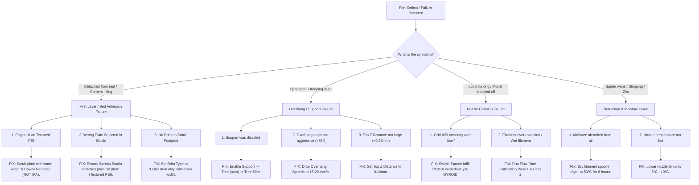

# Bambu Studio & Bambu Lab A1 Master Knowledge Base
**Author:** Antigravity (Master 3D Printing Agent)  
**Reference Source:** [Bambu Lab Official Wiki (Bambu Studio)](https://wiki.bambulab.com/en/bambu-studio)  
**Target Printer:** Bambu Lab A1 (with AMS Lite) & Bambu Lab Ecosystem

---

## 1. Master Knowledge Graph

```mermaid
graph TD
    %% Root Node
    BS["Bambu Studio Ecosystem"]

    %% Main Branches
    BS --> UI["1. Studio Workspace & Tools"]
    BS --> SLICE["2. Slicing Engine & Parameters"]
    BS --> MAT["3. Filament & Material Matrix"]
    BS --> A1["4. Hardware Architecture (Bambu Lab A1)"]
    BS --> CALIB["5. Calibration & Quality Tuning"]
    BS --> DIAG["6. Defect Diagnosis & Failure Tree"]

    %% Branch 1: UI & Tools
    UI --> UI_PREP["Prepare Tab (Model Manipulation)"]
    UI --> UI_PREV["Preview Tab (G-code & Layer Inspection)"]
    UI --> UI_DEV["Device Tab (Real-Time Control & Monitoring)"]
    UI_PREP --> TOOL_ORIENT["Auto-Orient / Lay on Face ('F')"]
    UI_PREP --> TOOL_CUT["Cut Tool (Connectors, Dowels, Dovetails)"]
    UI_PREP --> TOOL_PAINT["Color Paint Tool (Filament Assignment)"]
    UI_PREP --> TOOL_MOD["Modifiers & Blockers (Per-Region Settings)"]
    UI_PREP --> TOOL_VLH["Variable Layer Height (Adaptive Quality)"]

    %% Branch 2: Slicing Engine
    SLICE --> S_QUAL["Quality (Layer Height, Seam, Precision)"]
    SLICE --> S_STR["Strength (Walls, Top/Bottom, Infill)"]
    SLICE --> S_SPD["Speed (Volumetric Speed, Acceleration)"]
    SLICE --> S_SUP["Support (Tree vs Standard, Z-Distance)"]
    SLICE --> S_OTH["Others (Brim, Prime Tower, Flush)"]

    S_STR --> INF_GYR["Infill: Gyroid (Anti-Collision Master)"]
    S_STR --> WALL_LOOP["Wall Loops (Minimum 3 for Structural)"]
    S_SUP --> TREE_AUTO["Tree (Auto) -> Tree Slim / Tree Hybrid"]
    S_SUP --> Z_DIST["Top Z Distance (0.16 - 0.2mm for Clean Removal)"]
    S_OTH --> BRIM_OUT["Outer Brim (5mm+ for Bed Adhesion)"]

    %% Branch 3: Material Matrix
    MAT --> F_PLA["PLA Family (Basic, Matte, Silk, Tough, CF)"]
    MAT --> F_PETG["PETG (Tough, Heat-Resistant, Low-Fan)"]
    MAT --> F_TPU["TPU (Flexible 95A - Direct Spool Only, No AMS)"]
    MAT --> F_ABS["ABS / ASA (Warp Prone, Needs Draft Shield/Chamber)"]
    
    F_PLA --> PLA_SILK["PLA Silk: High Temp (220°C+), Low Speed (50mm/s for Shine)"]
    F_PLA --> PLA_MATTE["PLA Matte: Slightly Higher Temp, Low Retraction"]
    F_PLA --> PLA_BASIC["PLA Basic: High Speed, Great Adhesion, All-Rounder"]

    %% Branch 4: Hardware
    A1 --> A1_KIN["Kinematics: Bed-Slinger (Y-axis Bed Motion)"]
    A1 --> A1_FLOW["Eddy Current Sensor (Real-Time Dynamic Flow Rate)"]
    A1 --> A1_AMS["AMS Lite (4-Spool Active Feeder & Purge)"]
    A1 --> A1_PEI["Textured PEI Plate (Requires Warm Soap Wash)"]
    A1_KIN --> A1_RULE["Bed Movement Rule: Tall parts need Brims + Gyroid"]

    %% Branch 5: Calibration
    CALIB --> C_DYN["Flow Dynamics Calibration (K-Factor / Pressure Advance)"]
    CALIB --> C_RATE["Flow Rate Calibration (Pass 1 & Pass 2 Extrusion Multiplier)"]
    CALIB --> C_VIB["Vibration Compensation (Input Shaping Resonance Testing)"]
    CALIB --> C_NOISE["Active Motor Noise Cancellation (Silence Steppers)"]

    %% Branch 6: Defect Diagnosis
    DIAG --> DEF_ADH["Poor Bed Adhesion / Warping"]
    DIAG --> DEF_SPAG["Spaghetti / Detached Parts"]
    DIAG --> DEF_STR["Stringing & Oozing"]
    DIAG --> DEF_KNOCK["Nozzle Colliding with Model"]
    
    DEF_ADH --> SOL_ADH["Fix: Wash PEI with Dish Soap + Outer Brim 5mm"]
    DEF_SPAG --> SOL_SPAG["Fix: Enable Tree Supports under Overhangs > 50°"]
    DEF_KNOCK --> SOL_KNOCK["Fix: Switch Grid Infill to Gyroid + Calibrate Z-Hop"]
    DEF_STR --> SOL_STR["Fix: Dry Filament (Moisture) + Increase Retraction"]
```



---

## 2. Core Slicing Parameters & Master Configuration Rules

### 2.1 Quality Tab
| Parameter | Default | Master Value | Why & Operational Impact |
| :--- | :--- | :--- | :--- |
| **Layer Height** | `0.20 mm` | `0.16 mm` (Optimal) / `0.12 mm` (High Detail) | Balances print speed with staircase-free curved surfaces and sharp features (eyes, jewelry, text). |
| **First Layer Height** | `0.20 mm` | `0.20 mm` | Crucial for bed adhesion and squish into the textured PEI plate valleys. |
| **Seam Position** | `Nearest` | `Back` or `Aligned` | Prevents ugly z-seam zits across prominent surfaces (faces, front designs). Hides seam at the rear. |
| **Scarf Joint Seam** | `Disabled` | `Contour / Hole` (Bambu Studio v1.9+) | Smooths the layer transition point to make the Z-seam nearly invisible. |
| **Adaptive Layer Height** | Off | Enabled for sculpts | Automatically thins layers on gentle slopes and thickens them on vertical walls. |

---

### 2.2 Strength Tab
| Parameter | Default | Master Value | Why & Operational Impact |
| :--- | :--- | :--- | :--- |
| **Wall Loops** | `2` | **`3` to `4`** | Dramatically improves perimeter tensile strength, prevents infill show-through ("ghosting"), and seals against moisture. |
| **Top Shell Layers** | `4` | **`5` to `6`** | Eliminates "pillowing" (tiny holes in flat roofs caused by infill gaps). |
| **Bottom Shell Layers** | `3` | **`4` to `5`** | Solid base foundation prevents bed pattern telegraphing into the print. |
| **Sparse Infill Density** | `15%` | `12%` - `15%` (Decor) / `25%` - `40%` (Functional) | More than 20% adds marginal strength for decorative pieces, only wasting filament. |
| **Sparse Infill Pattern** | `Grid` | **`Gyroid` (MANDATORY)** | **Grid infill is the #1 killer of 3D prints on bed-slingers.** Grid lines cross over each other on the same plane; nozzle hits the intersection, making a clicking sound and knocking the print off the bed. Gyroid never intersects itself and has equal strength in all 3 axes (X, Y, Z). |

---

### 2.3 Support Tab (Zero-Defect Sculptures & Idols)
| Parameter | Default | Master Value | Why & Operational Impact |
| :--- | :--- | :--- | :--- |
| **Enable Support** | `Off` | **`On` (Checked)** | Essential for any geometry with overhang angle greater than 45° - 50°. |
| **Support Type** | `Standard` | **`Tree (auto)`** | Tree supports sprout like branches around the model without touching vertical walls, leaving minimal scarring. |
| **Tree Support Style** | `Tree Default` | **`Tree Slim`** or **`Tree Hybrid`** | `Tree Slim` consumes 40% less filament and snaps off effortlessly without snapping off delicate statue hands or fingers. |
| **Top Z Distance** | `0.20 mm` | `0.16 mm` (0.4mm nozzle) / `0.20 mm` (Silk PLA) | The vertical air gap between support top and model surface. Too small = support fuses permanently. Too large = sagging noodles. |
| **Top Interface Layers** | `2` | `3` (Concentric) | Forms a solid flat ceiling on top of branches for the actual model overhang to rest cleanly. |
| **Support / Model XY Distance** | `0.35 mm` | `0.50 mm` | Prevents tree branches from welding to the vertical side walls of the print. |

---

### 2.4 Speed Tab (The Surface Finish Engine)
| Parameter | Default (A1 Speed) | Silk / Precision Mode | Why & Operational Impact |
| :--- | :--- | :--- | :--- |
| **Outer Wall Speed** | `120 - 200 mm/s` | **`50 - 60 mm/s`** | **CRITICAL for PLA Silk & Metallic Finishes.** High speed turns shiny plastic into dull, matte chalky finish. Slow speed allows the polymer chains to align and create a mirror shine. |
| **Inner Wall Speed** | `250 - 300 mm/s` | `150 mm/s` | Balances speed with internal dimensional stability. |
| **Overhang Speed (75% - 100%)** | `30 mm/s` | `15 - 20 mm/s` | Gives auxiliary and part cooling fans enough dwell time to freeze molten plastic in mid-air before it droops. |
| **Travel Speed** | `500 mm/s` | `500 mm/s` | A1 kinematics handle this effortlessly without losing steps. |

---

### 2.5 Others Tab (Adhesion & Multi-Color)
| Parameter | Default | Master Value | Why & Operational Impact |
| :--- | :--- | :--- | :--- |
| **Brim Type** | `Auto` | **`Outer brim only`** | Auto often skips brims on small contact areas. Outer brim forms an anchor skirt around the model base. |
| **Brim Width** | `5 mm` | **`5 mm` to `8 mm`** | Keeps tall or narrow prints from rocking back and forth during high Y-axis acceleration on the A1. |
| **Brim-Object Gap** | `0.1 mm` | `0.12 mm` | Ensures brim provides adhesion while still being peelable by hand with zero cleanup knife marks. |
| **Prime Tower** | Enabled (AMS) | Enabled | Stabilizes nozzle pressure and cleans nozzle tip after every AMS filament retraction/purge. |

---

## 3. Complete Filament Engineering Matrix

```
+---------------+-------------------+---------------+------------------+-----------------------+-----------------------------+
| Filament Type | Nozzle Temp Range | Bed Temp (PEI)| Max Vol. Speed   | Fan Speed / Cooling   | Crucial Master Rules        |
+---------------+-------------------+---------------+------------------+-----------------------+-----------------------------+
| PLA Basic     | 210°C - 225°C     | 60°C - 65°C   | 21 - 24 mm³/s    | 100% Part Cooling     | King of reliability.        |
| PLA Matte     | 205°C - 215°C     | 60°C - 65°C   | 18 - 20 mm³/s    | 100% Part Cooling     | Avoid overheating or jams.  |
| PLA Silk      | 220°C - 230°C     | 65°C          | 12 - 14 mm³/s    | 80% - 100%            | Must print outer wall <60mm/s|
| PLA-CF        | 215°C - 230°C     | 60°C - 65°C   | 16 - 18 mm³/s    | 80% - 100%            | Hardened steel nozzle rqd.  |
| PETG Basic    | 240°C - 255°C     | 70°C - 75°C   | 12 - 16 mm³/s    | 20% - 50% (Low Fan)   | Stringy when wet; slow down.|
| TPU 95A       | 220°C - 235°C     | 35°C - 45°C   | 3 - 5 mm³/s      | 60% - 80%             | NEVER use in AMS Lite!      |
| ABS / ASA     | 250°C - 270°C     | 90°C - 100°C  | 16 - 20 mm³/s    | 0% - 20% (No drafts)  | Severe warp on A1 open bed! |
+---------------+-------------------+---------------+------------------+-----------------------+-----------------------------+
```

---

## 4. Hardware Master Guide: Bambu Lab A1 Bed-Slinger Architecture

The **Bambu Lab A1** differs fundamentally from CoreXY printers (like P1S and X1C):
1. **Kinematics:** The print bed moves forward and backward along the Y-axis. At 500 mm/s² acceleration, this creates strong centrifugal and inertial forces on tall objects.
   * **Rule 1:** Always orient tall, narrow objects so their longest cross-section is aligned with the Y-axis.
   * **Rule 2:** Always apply a 5–8 mm Brim for any model whose height is more than 3 times its base width.
   * **Rule 3:** Always use **Gyroid Infill** so nozzle inertia does not knock the model loose during rapid bed reversals.

2. **Flow Dynamics with Eddy Current Sensor:**
   * The A1 toolhead features a high-frequency eddy current sensor directly measuring nozzle pressure at the melt-zone.
   * **Rule:** Always keep **"Flow Dynamics Calibration"** ticked on the pre-print screen. It auto-tunes Pressure Advance (K-factor) without needing manual pattern calibration!

3. **AMS Lite Operation:**
   * Uses RFID tags on genuine Bambu spools to auto-detect material and color.
   * Uses spring-loaded spool tensioners. If using lightweight cardboard spools, insert a printable spool ring/adapter to prevent skipping.

---

## 5. Master Troubleshooting Decision Tree



---

## 6. Bambu Lab A1 Golden Pre-Print Checklist (The 100% Success Rule)

Before pressing "Print" on Bambu Studio or sending G-code to your A1:

1. [ ] **Bed Cleanliness:** Wash plate with warm water and dish soap every 5-10 prints. Avoid touching the printing area with bare fingers.
2. [ ] **Plate Match:** Verify Bambu Studio says `Textured PEI Plate` (and physical plate is seated properly against the rear alignment tabs).
3. [ ] **Filament Assignment:** Ensure the active color/slot matches what is loaded in the AMS Lite.
4. [ ] **Infill Integrity:** Infill is set to **Gyroid** at 12–15%.
5. [ ] **Overhang Protection:** If the model has floating features, **Tree (auto)** is enabled.
6. [ ] **Bed Anchorage:** If footprint is narrow or tall, **Outer Brim (5mm)** is enabled.
7. [ ] **Pre-Print Dialog Boxes:** Both **"Bed Leveling"** and **"Flow Dynamics Calibration"** are checked.
8. [ ] **Clear Path:** Ensure the bed has full clearance in the rear and front so it does not collide with walls or cables during rapid Y-axis moves.

