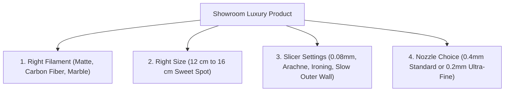

# Showroom Luxury & Ultra-HD 3D Printing Guide
**Target Printer:** Bambu Lab A1 / Bambu Studio  
**Target Goal:** Make any 3D print look like a premium ₹3,000 – ₹5,000 showroom product instead of a cheap plastic toy.  
**Author:** Antigravity 3D Master Agent

---

## 1. The Golden Formula Overview

To make a 3D print look like an expensive store-bought product, you need 4 things working together:

---

## 2. Best Filaments for a Luxury Finish

Most beginners use shiny **PLA Basic**, which makes layer lines very visible. For a luxury showroom look, use these filaments instead:

### 1. PLA Matte (The #1 Best Choice)
* **Why it works:** It does not reflect light. This completely hides 100% of the 3D print layer lines.
* **Look & Feel:** Looks like high-end injection-molded plastic or ceramic clay.
* **Best Colors:** Ivory White, Charcoal Black, Desert Tan.

### 2. PLA-CF (Carbon Fiber Filled)
* **Why it works:** Contains real microscopic carbon fiber strands.
* **Look & Feel:** Gives a rich, dark textured gray finish, identical to modern sports car interior parts.

### 3. Marble PLA (Stone / Granite Look)
* **Why it works:** Has tiny dark speckles mixed throughout the filament.
* **Look & Feel:** Perfect for statues and spiritual idols. It looks exactly like genuine carved granite or marble stone.

### 4. PLA Silk (Gold / Bronze)
* **Why it works:** Gives a metallic mirror shine.
* **Important Rule:** You **must print the outer wall slowly (40 – 50 mm/s)**. If you print fast, the shine disappears and it turns dull.

---

## 3. Best Model Size & Height (The 12 cm – 16 cm Rule)

* **Why 4 cm – 5 cm is NOT ideal for full HD:**
  * When a human or god statue is shrunk to 4 cm, facial details like eyes, lips, and jewelry shrink to 0.2 mm. A 0.4 mm nozzle cannot draw details smaller than its own hole.
* **Why 12 cm – 16 cm (120 mm – 160 mm) is the Golden Sweet Spot:**
  * At 12 to 15 cm height, eyes are 3 mm wide and fingers are 2 mm thick.
  * Your 0.4 mm nozzle has plenty of room to carve every tiny fold of fabric, fingernail, and crown jewel in razor-sharp HD detail.

---

## 4. The 5 Secret Slicer Settings in Bambu Studio

Change these 5 settings in Bambu Studio to instantly double your print quality:

### ① Layer Height: Set to `0.08 mm` or `0.12 mm`
* **Where to find:** In the left panel under **Process Preset**.
* **Why:** Standard `0.20 mm` leaves visible horizontal lines. A `0.08 mm` layer is as thin as a human hair. You can run your fingernail across the surface and feel zero layer lines—it will feel smooth like glass.

### ② Wall Generator: Change to `Arachne`
* **Where to find:** **Quality tab > Wall generator > Arachne**.
* **Why:** Standard "Classic" wall generator always prints a fixed 0.4 mm line. **Arachne** dynamically thickens or thins the line from 0.2 mm to 0.6 mm to fit into tiny gaps, capturing ultra-fine details like sharp noses and fingers.

### ③ Ironing: Turn ON for Flat Top Surfaces
* **Where to find:** **Quality tab > Ironing > Enable Ironing (Tick checkbox)**.
* **Why:** After finishing a flat top surface, the nozzle glides over it like a hot clothes iron without extruding, melting all tiny ridges flat. The top surface becomes mirror-smooth.

### ④ Scarf Joint Seam: Hide the Z-Seam
* **Where to find:** **Quality tab > Seam position > Scarf joint seam** (Bambu Studio v1.9+).
* **Why:** Normal 3D prints show an ugly vertical zipper line where each layer starts and stops. A scarf joint tapers the seam so it blends 100% invisibly into the model.

### ⑤ Outer Wall Speed: Slow Down to `40 – 50 mm/s`
* **Where to find:** **Speed tab > Outer wall > set to 40 or 50 mm/s**.
* **Why:** The Bambu Lab A1 can move at 200 mm/s, but high speed causes tiny micro-vibrations (ghosting/ringing). Slowing the outer wall to 40–50 mm/s guarantees a flawless mirror surface.

---

## 5. Master Hardware Secret: The `0.2 mm Nozzle`

Your Bambu Lab A1 has a quick-swap nozzle system that takes only 30 seconds to swap.

* If you want to print small miniatures, jewelry, or 4 cm idols in extreme microscopic detail, buy the official **Bambu 0.2 mm Nozzle**.
* A 0.2 mm nozzle prints with half the line width of a standard nozzle, giving you **Resin / SLA printer quality on your Bambu A1!**

---

## 6. Quick 1-Line Luxury Formula Checklist

> **PLA Matte (Ivory or Black) OR Marble PLA**  
> `+` **12 cm to 16 cm Model Height**  
> `+` **0.08 mm or 0.12 mm Layer Height**  
> `+` **Arachne Wall Generator**  
> `+` **40 – 50 mm/s Outer Wall Speed**  
> `+` **Ironing ON & Scarf Seam ON**  
> **= 100% Guaranteed Showroom Luxury Quality Product!**
