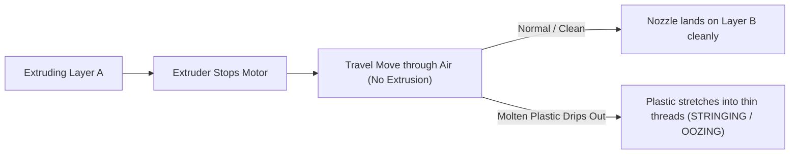

# 3D Printing Stringing & Oozing Deep Dive Guide
**Target Machine:** Bambu Lab A1 / Direct Drive 3D Printers  
**Defect Name:** Stringing / Oozing / Spider-webbing (நூல் நூல் போல பிளாஸ்டிக் இழுத்தல்)  
**Author:** Antigravity Master 3D Agent

---

## 1. What is Stringing? (நூல் நூல் பிரச்சனை என்றால் என்ன?)

When the 3D printer nozzle moves from one point of the model to another through open air without extruding (called a **Travel Move**), the flow of molten plastic should completely stop. 

If molten plastic continues to seep or drip out of the nozzle tip during travel, it stretches out like hot melted mozzarella cheese or chewing gum, leaving behind thin, hair-like plastic threads or cobwebs connecting different parts of the print.



---

## 2. Difference Between Stringing, Whispering Hairs & Spaghetti

| Defect Name | Visual Appearance | Physical Cause | Immediate Solution |
| :--- | :--- | :--- | :--- |
| **Micro-Stringing / Cobwebs** | Thin spiderwebs, easy to wipe off with a finger or lighter. | Mild moisture or slight excess temperature (5°C too hot). | Lower nozzle temp by 5°C; store spool with silica gel. |
| **Heavy Oozing / Branching** | Thick tree-like branches or solid horns sticking out sideways. | Severe moisture (wet filament) or insufficient retraction. | Dry filament in oven/dryer for 5 hours at 50°C. |
| **Spaghetti Failure** | Massive nest of curly loose plastic noodles piled on the bed. | Printing in mid-air (Missing support or model detached from bed). | Enable Tree Support; add 5mm Brim; clean PEI plate. |

---

## 3. The 4 Deep Root Causes (நூல் பிரச்சனைக்கான 4 உண்மையான காரணங்கள்)

### Cause 1: Moisture in the Filament (ஈரப்பதம்) — 75% of All Cases
* **The Mechanism:** Polymers like PLA, PETG, and TPU are **hygroscopic**—they naturally absorb ambient humidity directly from the room air.
* **What happens inside the hotend:** When damp filament enters the 220°C melt zone, the trapped microscopic water droplets instantly flash-boil into **high-pressure steam**.
* **The Consequence:** Steam expands to over **1,600 times** the volume of liquid water. This internal expansion forces molten plastic out through the 0.4mm nozzle tip like an automatic syringe, completely overriding any retraction the motor attempts.
* **Telltale Symptoms:**
  1. A distinctive **faint popping, snapping, or crackling sound** coming from the nozzle while printing.
  2. Tiny bubbles, rough pimples, or craters (zits) along the outer wall surface.

---

### Cause 2: Excessive Nozzle Temperature (அதிக வெப்பம்)
* **The Mechanism:** Viscosity of thermoplastics is inversely proportional to temperature.
  * At optimal temperature (`210°C` for PLA), plastic has the consistency of thick viscous honey and stays in the melt chamber.
  * At excessive temperature (`230°C+`), the polymer chains shear easily and viscosity collapses into a watery consistency.
* **The Consequence:** Liquid plastic drips out under gravity alone while traveling over open gaps.

---

### Cause 3: Retraction Settings (ரீட்ராக்ஷன் குறைபாடு)
* **The Mechanism:** Before a travel move begins, the direct drive extruder motor reverses by a fraction of a millimeter to release nozzle chamber pressure and pull the molten meniscus upward (creating negative suction).
* **The Consequence on Bambu A1:**
  * Bambu A1 uses an ultra-short **Direct Drive** extruder right above the nozzle.
  * If retraction distance is set too low (e.g., `< 0.4 mm`), chamber pressure is not relieved.
  * If retraction speed is too slow, plastic drips before the pull is complete.
  * **Optimal A1 Direct Drive Setting:** Retraction distance `0.8 mm`, Retraction speed `30 – 40 mm/s`.

---

### Cause 4: Travel Speed & Z-Hop "Cheese Effect" (பயண வேகம்)
* **The Mechanism:** When eating hot pizza, pulling a slice away slowly stretches cheese into infinite strings; snapping it away quickly breaks the cheese cleanly.
* **The Consequence:**
  * **Travel Speed:** If the nozzle cruises slowly across gaps (`< 150 mm/s`), molten plastic has ample dwell time to sag and bridge the gap. At Bambu A1's full `500 mm/s` travel speed, strings are snapped clean before they form.
  * **Z-Hop:** When Z-Hop is enabled, the nozzle lifts straight up before moving. If plastic is hot, this vertical lift pulls a vertical thread upwards from the top layer.

---

## 4. Filament Material Vulnerability Matrix

```
+---------------+-------------------+---------------------------------------------------------+
| Filament Type | Stringing Risk    | Special Behavior & Handling Rule                        |
+---------------+-------------------+---------------------------------------------------------+
| PLA Basic     | Low - Moderate    | King of clean prints. Strings only when wet or too hot. |
| PLA Matte     | Very Low          | Chalky mineral fillers naturally reduce oozing.         |
| PLA Silk      | High              | Elastomers stretch like gum; requires lower temps.      |
| PETG          | Very High         | Extremely sticky; absorbs moisture in 48 hours.         |
| TPU 95A       | Severe            | Flexible rubber cannot retract fast; stringing common.  |
+---------------+-------------------+---------------------------------------------------------+
```

---

## 5. Diagnostic Decision Tree (Mermaid)

```mermaid
flowchart TD
    START["Noticed stringing/thin threads?"] --> Q_SOUND{"Do you hear popping/snapping sounds from nozzle?"}

    Q_SOUND -->|YES| WET["Filament is WET (Moisture)"]
    WET --> FIX_DRY["ACTION: Dry the spool in a filament dryer or on heated bed for 5 hrs @ 50°C"]

    Q_SOUND -->|NO| Q_TEMP{"What is your nozzle temperature?"}
    Q_TEMP -->|"> 220°C for PLA"| HOT["Temperature too high"]
    HOT --> FIX_TEMP["ACTION: Lower nozzle temperature by 5°C to 10°C in Bambu Studio"]

    Q_TEMP -->|"<= 215°C for PLA"| Q_FILAMENT{"Is it Silk PLA or PETG?"}
    Q_FILAMENT -->|YES| FIX_SILK["ACTION: Lower temperature to 210°C, set Travel Speed to 500 mm/s"]
    Q_FILAMENT -->|NO (PLA Basic)| FIX_RETRACT["ACTION: Check Retraction is set to 0.8mm and Wipe while retracting is ON"]
```

---

## 6. How to Fix Stringing Permanently (நிரந்தர தீர்வுகள்)

### Method 1: The Heated Bed Drying Trick (No dryer needed!)
If you do not own a dedicated filament drying oven:
1. Place your spool of filament directly flat on your **Bambu Lab A1 heated bed**.
2. Cut the bottom off an empty cardboard filament box (or punch 4–5 small air vent holes in the top).
3. Place the cardboard box over the spool like a lid.
4. Set bed temperature to **`50°C` for PLA** (or `65°C` for PETG) on the printer touchscreen.
5. Leave it for **4 to 6 hours**. The trapped dry warm air will bake out all moisture!

### Method 2: Bambu Studio Slicer Fine-Tuning
In Bambu Studio, open your Filament Preset settings:
* **Nozzle Temperature:** Lower initial/other layer temps from `220°C` to **`210°C – 212°C`**.
* **Others > Travel:** Ensure **Travel speed** is set to **`500 mm/s`**.
* **Extrusion > Retraction:**
  * Length: **`0.8 mm`**
  * Z-hop when retracting: **`Auto`** or **`Normal (0.2mm)`**
  * Wipe while retracting: **`Enabled (Tick)`** (wipes the nozzle against the inner perimeter before flight).

### Method 3: Quick Post-Processing Clean-Up
If a print already has light spiderwebs:
* Do not spend hours picking them off with your fingernails.
* Wave a **heat gun** or a standard **butane lighter flame** over the model rapidly for 1 second. The thin cobwebs vaporize instantly, leaving a mirror-clean plastic surface without damaging the statue!

