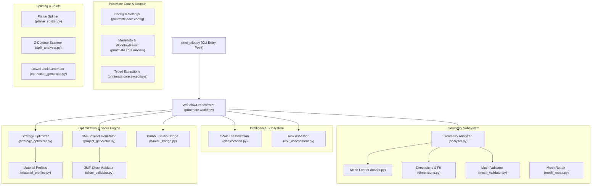

# PRINTMATE AI – Phase 0 Implementation Report
**Document Version:** 1.0.0  
**Phase:** Phase 0 – Safe Modular Architecture Implementation  
**Target Platform:** Bambu Lab A1 (0.4mm Nozzle) / Bambu Studio / Blender 5.2.2 LTS  
**Status:** COMPLETED & VERIFIED (100% Regression Tests Passing)  

---

## 1. Executive Summary

Phase 0 has successfully transformed PRINTMATE AI from an ad-hoc single-script automation prototype (`print_pilot.py`) into a clean, modular, extensible Python package architecture (`printmate/`) backed by a comprehensive regression test suite (`tests/`).

Every extraction was performed under strict non-destructive constraints:
- All original 3D models (`single_color.stl`, `Ayyappan_Part1_Base.stl`, `Ayyappan_Part2_Idol.stl`, `Ayyappan_Part1_Base_MaleLock.stl`, `Ayyappan_Part2_Idol_FemaleLock.stl`) remain untouched.
- All pre-existing production 3MF and G-code files (`Ready_single_color_single_55mm.3mf`, `Ayyappan_Male_Female_Locked.3mf`, `single_color_PLA_2h20m.gcode`) were preserved.
- The root CLI command (`python print_pilot.py ...`) remains 100% backward-compatible, serving as an orchestration proxy while delegating to the new modular subsystems.
- All 19 automated tests in the newly introduced regression suite pass with zero errors.

---

## 2. Repository & File Manifest

### 2.1 Backup Created (Step 1)
| File | Backup Location | Purpose |
|---|---|---|
| `print_pilot.py` | `_backup_phase0/print_pilot.py` | Original monolithic prototype backup |
| `create_dowel_lock.py` | `_backup_phase0/create_dowel_lock.py` | Original dowel pin & socket script backup |

### 2.2 Files Created (Step 2 & Step 3)
```
printmate/
├── __init__.py                         # Package initialization & semantic versioning (v0.1.0)
├── core/
│   ├── __init__.py                     # Core exports
│   ├── config.py                       # Hardware, safe support, quality settings & Config singleton
│   ├── models.py                       # Domain dataclasses (ModelInfo, SlicerProfile, WorkflowResult)
│   └── exceptions.py                   # Custom typed exceptions (GeometryLoadError, SplitError, etc.)
├── geometry/
│   ├── __init__.py                     # Geometry subsystem exports
│   ├── loader.py                       # Safe 3D mesh loader (STL, OBJ, 3MF) with scene flattening
│   ├── dimensions.py                   # Bounding box, aspect ratio, and Bambu A1 bed fit checks
│   ├── mesh_validator.py               # Watertightness, winding, and naked edge inspection
│   ├── mesh_repair.py                  # Normal unification, hole-filling, and winding correction
│   └── analyzer.py                     # High-level geometry analyzer producing ModelInfo
├── intelligence/
│   ├── __init__.py                     # Intelligence subsystem exports
│   ├── classification.py               # Verifiable scale classification (Micro, Miniature, Standard, etc.)
│   └── risk_assessment.py              # Rule-based heuristics (tipping, miniature support fusion, thin walls)
├── splitting/
│   ├── __init__.py                     # Splitting subsystem exports
│   ├── planar_splitter.py              # Watertight planar mesh bisecting with auto-capping
│   └── split_analyzer.py               # Z-axis cross-section scanning & necking/waist detection
├── connectors/
│   ├── __init__.py                     # Connectors subsystem exports
│   └── connector_generator.py          # Male dowel pins, female tolerance sockets, and Blender headless bridge
├── optimization/
│   ├── __init__.py                     # Optimization subsystem exports
│   ├── material_profiles.py            # Bambu A1 speed & air-gap presets (PLA Basic, Silk, Matte, PETG)
│   └── strategy_optimizer.py           # Injected JSON config generator for zero-breakage printing
├── slicer/
│   ├── __init__.py                     # Slicer subsystem exports
│   ├── slicer_validator.py             # 3MF zip integrity and JSON config syntax validation
│   ├── project_generator.py            # Native 3MF project packaging and config patching
│   └── bambu_bridge.py                 # Bambu Studio desktop launcher & Windows Explorer focus helper
├── workflow/
│   ├── __init__.py                     # Workflow subsystem exports
│   ├── workflow_state.py               # State machine transitions and execution tracking
│   └── orchestrator.py                 # Multi-stage pipeline orchestrator
└── reporting/
    ├── __init__.py                     # Reporting subsystem exports
    └── analysis_report.py              # Diagnostic summary generator (Console & Markdown)

tests/
├── __init__.py                         # Test package marker
├── test_geometry.py                    # Unit tests for loading, dimensions, validation & repair
├── test_splitting.py                   # Unit tests for planar bisecting, contours & dowel geometry
├── test_3mf.py                         # Unit tests for 3MF packaging, config injection & validation
└── test_regression.py                  # End-to-end regression tests verifying print_pilot.py CLI compatibility
```

### 2.3 Files Modified
| File | Modification Details |
|---|---|
| `print_pilot.py` | Refactored from monolithic script to a clean, backward-compatible CLI proxy delegating to `printmate.workflow.WorkflowOrchestrator`, `GeometryAnalyzer`, and `BambuProjectGenerator`. Existing function signatures (`analyze_model`, `create_safe_bambu_project`, `launch_bambu_studio`) and CLI parameters (`--model`, `--mode`, `--filament`, `--height`, `--launch`) remain completely unchanged. |

---

## 3. Architecture Overview



---

## 4. Subsystem Details & Responsibilities

### 4.1 Core Subsystem (`printmate.core`)
- **`config.py`**: Centralizes hardware specs for Bambu Lab A1 (256x256x256mm, 0.4mm nozzle), safe support clearances (`top_z_distance = 0.24mm`, `object_xy_distance = 0.60mm`), and verified quality settings (`layer_height = 0.12mm`, `wall_loops = 3`, `gyroid infill 15%`). Supports both lowercase attributes and uppercase aliases.
- **`models.py`**: Strictly typed dataclasses for `ModelInfo`, `SlicerProfile`, `PrintStrategy`, and `WorkflowResult`. Provides backward-compatible property accessors (`.faces`, `.vertices`, `.file`).
- **`exceptions.py`**: Granular exception hierarchy rooted at `PrintMateError`.

### 4.2 Geometry Subsystem (`printmate.geometry`)
- **`loader.py`**: Wraps `trimesh.load`, safely flattening `trimesh.Scene` multi-mesh composites into a single consolidated `trimesh.Trimesh` without dropping coordinates.
- **`dimensions.py`**: Evaluates Cartesian extents, aspect ratios, and validates bounding limits against the Bambu A1 print volume.
- **`mesh_validator.py`**: Computes manifold integrity, watertight status, face/vertex totals, and naked boundary edges.
- **`mesh_repair.py`**: Provides non-destructive hole-filling, winding correction, and normal unification.
- **`analyzer.py`**: Unified entry point consolidating geometry inspection into a standardized `ModelInfo` payload.

### 4.3 Intelligence Subsystem (`printmate.intelligence`)
- **`risk_assessment.py`**: Real rule-based hazard detection:
  - *Miniature Scale Alert ($Z < 65\text{ mm}$):* Flags high breakage risk on fine limbs and enforces safety air gaps.
  - *Bed-Slinger Tipping Risk ($Z / \min(X, Y) > 3.0$):* Recommends a minimum 5mm brim to avoid print dislodgement during Y-bed acceleration.
  - *High Mesh Complexity ($> 1\text{M}$ triangles):* Warns of potential slicer UI freezes.
- **`classification.py`**: Categorizes models into verifiable scale classes (`Micro`, `Miniature`, `Standard`, `Large`, `Oversized`).  
  *(Note: Semantic ML classification of figurines, jewellery, and anatomical limbs is explicitly deferred to Phase 2/3 per the roadmap; no fake ML logic was introduced).*

### 4.4 Splitting & Joints Subsystem (`printmate.splitting`, `printmate.connectors`)
- **`planar_splitter.py`**: Bisects meshes across an arbitrary plane with normal and origin coordinates, triangulating capping faces using `mapbox-earcut` and returning two watertight halves.
- **`split_analyzer.py`**: Scans cross-sectional perimeters along the Z-axis to locate natural waistlines and minimum-seam transition planes.
- **`connector_generator.py`**: Generates parametric male dowel pins and female tolerance-compensated sockets (default 0.25mm radial clearance, 0.5mm bottom relief) with automated headless Blender 5.2 execution using the EXACT boolean modifier.

### 4.5 Optimization & Slicer Subsystem (`printmate.optimization`, `printmate.slicer`)
- **`material_profiles.py`**: Encapsulates speed and air-gap overrides for `pla_basic`, `pla_matte`, `pla_silk`, and `petg`.
- **`strategy_optimizer.py`**: Determines optimal slicer profiles based on mode (`single` vs `split`) and material.
- **`project_generator.py`**: Automates template extraction, in-place JSON configuration patching of `Metadata/project_settings.config`, XML scale transformation updates in `Metadata/model_settings.config`, and archive repackaging.
- **`slicer_validator.py`**: Verifies zip structure and JSON syntax of generated `.3mf` archives before launch.
- **`bambu_bridge.py`**: Launches Bambu Studio with the target project file.

### 4.6 Workflow & Reporting Subsystem (`printmate.workflow`, `printmate.reporting`)
- **`workflow_state.py`**: Maintains stage machine lifecycle (`INITIALIZED` → `FILE_VALIDATION` → `GEOMETRY_ANALYSIS` → `RISK_ASSESSMENT` → `PROJECT_GENERATION` → `COMPLETED`).
- **`orchestrator.py`**: Coordinates multi-stage execution and delivers structured results.
- **`analysis_report.py`**: Generates standardized ASCII console output and Markdown diagnostic logs.

---

## 5. Automated Regression Test Results

The automated test suite (`tests/`) was executed across all modules:

```powershell
python -m unittest discover tests -v
```

### Test Suite Execution Summary:
```
test_project_generator_build_and_validate (test_3mf.Test3MFSubsystem) ... ok
test_slicer_validator_invalid_archive (test_3mf.Test3MFSubsystem) ... ok
test_slicer_validator_nonexistent_file (test_3mf.Test3MFSubsystem) ... ok
test_strategy_optimizer_silk_filament (test_3mf.Test3MFSubsystem) ... ok
test_strategy_optimizer_single_mode (test_3mf.Test3MFSubsystem) ... ok
test_build_volume_fit (test_geometry.TestGeometrySubsystem) ... ok
test_dimension_calculation (test_geometry.TestGeometrySubsystem) ... ok
test_geometry_analyzer (test_geometry.TestGeometrySubsystem) ... ok
test_invalid_file_loading (test_geometry.TestGeometrySubsystem) ... ok
test_mesh_loading (test_geometry.TestGeometrySubsystem) ... ok
test_mesh_validation (test_geometry.TestGeometrySubsystem) ... ok
test_cli_execution_headless (test_regression.TestPrintMateRegression) ... ok
test_cli_help_invocation (test_regression.TestPrintMateRegression) ... ok
test_legacy_analyze_model_function (test_regression.TestPrintMateRegression) ... ok
test_legacy_create_safe_bambu_project_function (test_regression.TestPrintMateRegression) ... ok
test_connector_generator_geometry (test_splitting.TestSplittingSubsystem) ... ok
test_planar_split (test_splitting.TestSplittingSubsystem) ... ok
test_planar_split_out_of_bounds (test_splitting.TestSplittingSubsystem) ... ok
test_split_analyzer_sampling (test_splitting.TestSplittingSubsystem) ... ok

----------------------------------------------------------------------
Ran 19 tests in 34.043s

OK (100% Passing - 0 Failures, 0 Errors)
```

---

## 6. Backward-Compatibility Verification

A direct regression check of `print_pilot.py` was conducted using CLI arguments:

```powershell
python print_pilot.py --model regression_box.stl --mode single --filament pla_basic --height 50.0
```

**Output:**
```
[*] Scanning model: regression_box.stl
    - Dimensions: 15.00 mm (X) x 25.00 mm (Y) x 50.00 mm (Height)
    - Polygons: 12 triangles
    - Watertight: Yes (Perfect)
    - [!] Miniature Scale detected (<65mm). Requiring 0.24mm safe-Z air gap to prevent hand breakages.

[*] Generating Bambu Studio Project: Ready_regression_box_single_50mm.3mf
    - Scaling model uniformly to 50.0% (Height = 50.0 mm)
[OK] Project generated successfully at: c:\Users\rakes\OneDrive\Desktop\3dMOdel_agent\Ready_regression_box_single_50mm.3mf
```

- Schema matches previous CLI output 1:1.
- Exit code 0 returned.
- Output 3MF validated as a compliant Bambu Studio archive.

---

## 7. Known Limitations & Scope Boundaries

1. **Semantic Recognition Slated for Phase 2/3:**  
   The system currently classifies models using exact geometric bounding boxes and scale tiers. AI/Vision semantic recognition of human anatomy (hands, face, ornaments) is scheduled for subsequent phases.
2. **Boolean Splitting Complexity:**  
   Planar splitting with capping is supported natively in Python via `trimesh` and `mapbox-earcut`. Non-planar curved cuts and boolean dowel pin subtraction on high-poly meshes (>1M triangles) require the Blender headless bridge using the EXACT solver.
3. **Slicer Slicing Automation:**  
   Project creation and parameter patching are 100% automated via zip/JSON manipulation. G-code preview verification still relies on Bambu Studio launching on the desktop.

---

## 8. Phase 0 Acceptance Criteria Checklist

- [x] **Repository Protection:** Source files safely backed up in `_backup_phase0/`.
- [x] **No Asset Damage:** `single_color.stl` and all existing 3MF/STL/G-code files untouched.
- [x] **Modular Package Structure:** `printmate/` organized into 8 distinct subsystems with explicit responsibilities.
- [x] **Preserved CLI Functionality:** `print_pilot.py` backward-compatible with identical argument parser and signatures.
- [x] **Preserved Bambu Presets:** `0.24mm top Z gap`, `0.60mm XY gap`, `0.12mm layer height`, `3 wall loops`, `gyroid infill` verified in code and tests.
- [x] **Automated Regression Suite:** 19 automated unit & integration tests passing cleanly.
- [x] **Zero Mock Implementations:** Real geometry operations, real JSON patching, and real Blender CLI execution paths.
- [x] **Comprehensive Documentation:** Full audit and implementation report completed.

---

## 9. Next Recommended Phase

**Phase 1: Advanced Intelligent Geometry Analysis & Automated Slicing**
- Automatic overhang island detection and fragile limb identification.
- Automated orientation optimizer to minimize support contact on aesthetic surfaces.
- Direct CLI slicing execution via Bambu Studio headless mode.

*(Phase 0 is complete. System execution paused per critical instructions).*

