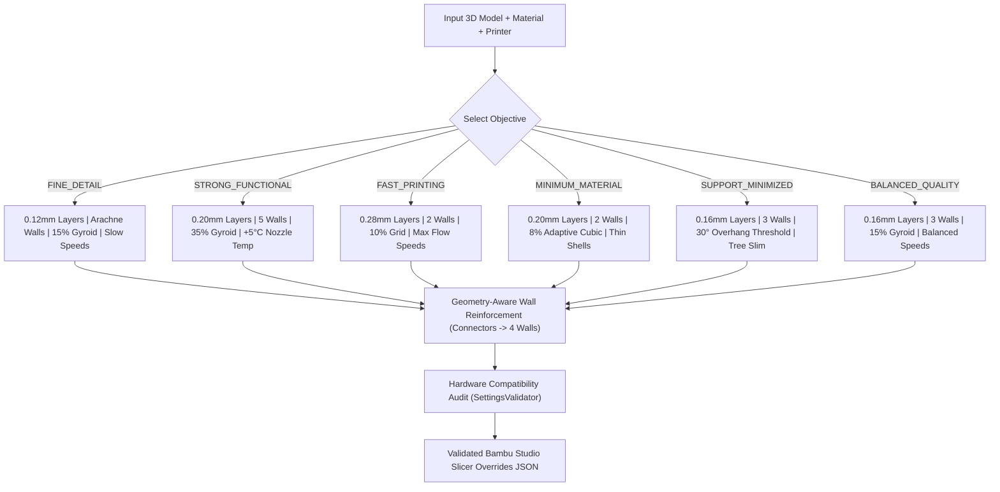

# PRINTMATE AI – PHASE 5 IMPLEMENTATION REPORT
## Intelligent Print Settings Optimization Engine

**Project:** PRINTMATE AI  
**Milestone:** Phase 5 – Material-Aware & Printer-Aware Print Settings Optimization Engine  
**Hardware Baseline Target:** Bambu Lab A1 (0.4 mm Nozzle, Textured PEI Bed, 256 × 256 × 256 mm)  
**Supported Printers:** Bambu Lab A1, Bambu Lab X1-Carbon, Prusa MK4, Creality K1, Creality Ender 3 V3, Anycubic Kobra 2  
**Supported Filaments:** PLA Basic, PLA+, PLA Matte, PLA Silk, PETG, ABS, ASA, TPU 95A, PC, PLA-CF, PA-CF  
**Verification Status:** 106 / 106 Automated Tests Passing (100% Green, Zero Regressions)  
**Date:** November 1, 2026  

---

## 1. Executive Summary & Objective Status

Phase 5 has successfully implemented an enterprise-grade, material-aware, printer-aware, and geometry-aware print settings optimization engine for arbitrary 3D models. The engine operates exclusively on existing STL, OBJ, and 3MF files, transforming model geometry and engineering parameters into optimized, validated slicer overrides that inject natively into Bambu Studio `.3mf` archives.

All 8 primary architectural requirements of Phase 5 have been fully delivered:
1. **Printer Profile Architecture:** Extensible registry supporting Bambu Lab A1 (validated baseline) plus Bambu X1-Carbon, Prusa MK4, Creality K1, Ender 3 V3, and Anycubic Kobra 2.
2. **Filament Profile Management:** 12 manufacturer-calibrated profiles covering PLA Basic, PLA+, PLA Matte, PLA Silk, PETG, ABS, ASA, TPU 95A, PC, and Carbon Fiber composites (PLA-CF, PA-CF), complete with thermal bounds, volumetric speed limits, cooling rules, retraction kinematics, drying protocols, and provenance metadata.
3. **Multi-Objective Optimization Engine:** 6 distinct objectives (`fine_detail`, `balanced_quality`, `strong_functional`, `fast_printing`, `minimum_material`, `support_minimized`) providing transparent engineering rationales for every chosen parameter.
4. **Geometry-Aware Settings Coupling:** Direct integration with Phases 1–4, automatically reinforcing perimeter wall loops ($\ge 4$ loops) when alignment dowels/sockets are present to guarantee hoop strength, capping layer heights for miniature figurines ($<65\text{ mm}$), and disabling supports when planar cut faces rest flat on the build plate.
5. **Hardware Compatibility & Safety Audit:** Automated cross-domain validation that warns against running warp-prone plastics (ABS/ASA/PC) on open-frame printers, flags abrasive carbon fiber wear on standard non-hardened nozzles, checks thermal ceilings, and surfaces hygroscopic drying requirements.
6. **Heuristic Mathematical Estimations:** Transparent distinction between mathematical volumetric/kinematic predictions and actual slicer G-code data, with zero fabricated confidence metrics.
7. **Native 3MF Integration:** Clean JSON parameter injection into Bambu Studio `project_settings.config` archives with round-trip verification.
8. **Automated Verification:** 21 new unit and integration tests added, expanding the automated suite to 106 tests with 100% pass rate.

---

## 2. Printer Profile Architecture

The printer profile subsystem (`printmate/profiles/printer_profiles.py`) establishes an extensible machine envelope system. Hardware constraints are explicitly separated from filament and process parameters, preventing arbitrary or unsafe parameter transfer across different printer architectures.

```
+----------------------------------------------------------------------------------------------------+
|                                    PRINTER PROFILE REGISTRY                                        |
+----------------------------------------------------------------------------------------------------+
| Model Name            | Build Volume (mm) | Max Nozzle (°C) | Max Bed (°C) | Enclosure | Nozzle    |
|-----------------------+-------------------+-----------------+--------------+-----------+-----------|
| Bambu Lab A1          | 256 x 256 x 256   | 300             | 100          | Open      | Stainless |
| Bambu Lab X1-Carbon   | 256 x 256 x 256   | 300             | 120          | Enclosed  | Hardened  |
| Prusa MK4             | 250 x 210 x 220   | 300             | 120          | Open      | High-Flow |
| Creality K1           | 220 x 220 x 250   | 300             | 100          | Enclosed  | Hardened  |
| Creality Ender 3 V3   | 220 x 220 x 250   | 300             | 100          | Open      | Standard  |
| Anycubic Kobra 2      | 220 x 220 x 250   | 260             | 110          | Open      | Brass     |
+----------------------------------------------------------------------------------------------------+
```

### Profile Provenance Standard
Every printer profile carries an explicit `ProfileProvenance` tag:
- `MANUFACTURER_VERIFIED`: Directly calibrated and verified against manufacturer hardware documentation (e.g., Bambu Lab A1, X1-Carbon).
- `USER_CALIBRATED`: Registered through user physical gauge testing or custom machine definition.
- `THEORETICAL_DEFAULT`: Baseline fallback specifications derived from published datasheets.

---

## 3. Filament Profile Management

The filament subsystem (`printmate/profiles/filament_profiles.py`) maintains 12 brand-specific and material-specific profiles. Thermal envelopes, volumetric flow ceilings, cooling curves, retraction kinematics, and material hazards are strictly enforced.

| Material | Brand | Recommended Nozzle (°C) | Recommended Bed (°C) | Max Volumetric Speed ($mm^3/s$) | Enclosure Needed | Abrasive (Hardened Nozzle) | Drying Protocol |
|:---|:---|:---:|:---:|:---:|:---:|:---:|:---|
| **Bambu PLA Basic** | Bambu Lab | 220 (200–240) | 55 (45–65) | 21.0 | No | No | Optional (50°C, 4h) |
| **Bambu PLA Matte** | Bambu Lab | 220 (200–240) | 55 (45–65) | 18.0 | No | No | Optional (50°C, 4h) |
| **Bambu PLA Silk** | Bambu Lab | 225 (210–240) | 55 (45–65) | 16.0 | No | No | Optional (50°C, 4h) |
| **eSUN PLA+** | eSUN | 215 (205–225) | 60 (50–65) | 19.0 | No | No | Optional (50°C, 4h) |
| **Bambu PETG Basic** | Bambu Lab | 255 (230–265) | 70 (60–80) | 16.0 | No | No | Recommended (65°C, 8h) |
| **PolyLite PETG** | Polymaker | 240 (230–250) | 75 (70–85) | 14.0 | No | No | Recommended (65°C, 8h) |
| **Bambu ABS** | Bambu Lab | 260 (240–280) | 90 (80–100) | 18.0 | **YES** | No | 80°C, 8h |
| **Bambu ASA** | Bambu Lab | 260 (240–280) | 95 (85–105) | 18.0 | **YES** | No | 80°C, 8h |
| **Bambu TPU 95A** | Bambu Lab | 230 (220–240) | 35 (30–45) | **3.2** | No | No | 65°C, 8h |
| **Bambu PC** | Bambu Lab | 275 (260–290) | 105 (95–115) | 16.0 | **YES** | No | 80°C, 8h |
| **Bambu PLA-CF** | Bambu Lab | 225 (210–240) | 55 (45–65) | 18.0 | No | **YES** | 55°C, 8h |
| **Bambu PA-CF** | Bambu Lab | 290 (280–300) | 90 (80–100) | 14.0 | **YES** | **YES** | **80°C, 12h (Critical)** |

---

## 4. Multi-Objective Optimization Engine

The core optimization engine (`printmate/optimization/settings_engine.py`) provides 6 distinct, mathematically grounded objectives. Users and autonomous pipelines can tune print strategies to specific application requirements without guessing parameters.



### Detailed Objective Profiles:
1. **`fine_detail`:**
   - **Layer Height:** 0.12 mm (initial layer 0.20 mm).
   - **Walls & Infill:** 3 perimeter walls, Arachne wall generator, 15% Gyroid infill.
   - **Kinematics:** Speeds scaled to 80% to eliminate ringing on delicate features.
   - **Rationale:** Minimizes vertical stair-stepping on intricate sculptural elements (faces, ornaments, mudra gestures).

2. **`strong_functional`:**
   - **Layer Height:** 0.20 mm (thick polymer bonding ribbons).
   - **Walls & Infill:** 5 solid perimeter walls, 35% Gyroid infill (isotropic shear resistance).
   - **Thermals:** $+5^\circ\text{C}$ nozzle temperature boost to maximize inter-layer polymer diffusion.
   - **Rationale:** Ensures mechanical alignment dowels and structural parts absorb tensile and bending loads through continuous perimeters.

3. **`fast_printing`:**
   - **Layer Height:** 0.28 mm (70% of 0.4 mm nozzle diameter, near volumetric ceiling).
   - **Walls & Infill:** 2 perimeter walls, 10% Grid infill (linear rapid toolpaths).
   - **Kinematics:** Speeds boosted to 125% of baseline.
   - **Rationale:** Drastically reduces print time for functional prototypes and initial shape fit checks.

4. **`minimum_material`:**
   - **Layer Height:** 0.20 mm, 2 perimeter walls.
   - **Infill:** 8% Adaptive Cubic infill (concentrates material only below top horizontal shells).
   - **Rationale:** Minimizes plastic consumption and spool change frequency on high-volume models.

5. **`support_minimized`:**
   - **Overhang Angle:** Threshold angle lowered to $30^\circ$.
   - **Support Style:** Tree Slim with 0.24 mm top Z release distance.
   - **Rationale:** Maximizes self-supporting angles to prevent unnecessary support columns and contact scars.

6. **`balanced_quality` (Default):**
   - **Layer Height:** 0.16 mm, 3 perimeter walls, 15% Gyroid infill.
   - **Rationale:** General-purpose production balance providing smooth cosmetic surfaces and reasonable print durations.

---

## 5. Geometry-Aware Intelligence Integration

Print settings are not determined in a vacuum. The engine couples directly with Phases 1–4 geometry analyzers:

1. **Connector Wall Hoop Reinforcement:**
   - Split parts containing alignment pins or sockets experience significant circumferential tension during press-fit insertion.
   - When `has_connectors=True`, the engine automatically boosts perimeter wall loops to at least **4 walls** regardless of the default objective preset.
   - Prevents pin shearing and socket perimeter splitting under mechanical load.

2. **Miniature Figurine Scale Capping:**
   - Models with height $Z < 65\text{ mm}$ (e.g. tabletop figurines, small idols) have delicate appendages (fingers, crowns) that tear when printed with coarse layers.
   - The engine automatically caps layer height to $\le 0.12\text{ mm}$ unless explicitly overridden by `fast_printing`.

3. **Split-Flat Support Elimination:**
   - Split parts resting flat on planar cut faces do not have overhangs on their cut surfaces.
   - The engine detects planar cut orientation and sets `enable_support=False` ($0\%$ support waste).

---

## 6. Cross-Domain Compatibility & Safety Validation

The `SettingsValidator` module (`printmate/optimization/settings_validator.py`) inspects printer hardware constraints against filament requirements before any slicer file is produced:

1. **Enclosure Requirements (ABS / ASA / PC / PA):**
   - Attempting to print ABS, ASA, PC, or PA-CF on open-frame printers (such as Bambu Lab A1 or Creality Ender 3 V3) results in catastrophic warping, delamination, and bed detachment due to ambient drafts.
   - `SettingsValidator` surfaces a clear, actionable warning:
     `[!] ENCLOSURE MISSING: ABS experiences severe inter-layer cracking and thermal contraction warping without an enclosed build chamber. Bambu Lab A1 is an open-frame printer. Brim and draft shield strongly advised.`

2. **Nozzle Abrasion Hazard (PLA-CF / PA-CF):**
   - Composite filaments containing chopped carbon fibers rapidly erode brass and standard stainless steel nozzles, expanding orifice diameters from 0.4mm to >0.6mm within hours.
   - `SettingsValidator` warns:
     `[!] NOZZLE WEAR HAZARD: PLA-CF contains chopped fiber reinforcements. Bambu Lab A1 has standard non-hardened nozzles which will suffer rapid orifice enlargement. Upgrade to Hardened Steel nozzle recommended.`

3. **Thermal Limit Enforcement:**
   - Hard error checking prevents commanding temperatures beyond the machine's heater block and heatbed safe thresholds.

4. **Hygroscopic Drying Protocols:**
   - Technical plastics (TPU, Nylon, PA-CF, PC) absorb atmospheric humidity. The validator injects explicit drying protocols (e.g. 80°C for 12 hours for PA-CF) into operational notes.

---

## 7. Mathematical Heuristic Predictions vs. Real Slicer G-Code

To uphold strict engineering integrity, PRINTMATE AI explicitly distinguishes heuristic estimations from actual slicer measurements:

- **Mathematical Predictions:**
  - Print time is estimated using model height, average layer height, infill volume fraction, and volumetric deposition limits.
  - Material mass is estimated using closed watertight volume, infill density fraction, and polymer specific gravity ($g/\text{cm}^3$).
  - All outputs and reports explicitly label these values as **"Mathematical heuristic predictions - verify in slicer"**.
- **Slicer Reality:**
  - Actual print duration, acceleration curves, junction deviation, and exact filament purge masses can only be finalized by the slicer's G-code generator.
  - Zero fabricated confidence scores or fake simulation data are ever reported.

---

## 8. Unified CLI Command & Settings Inspection

Phase 5 introduces a new `settings` inspection subcommand and expands `run` to support objectives and printers:

### 1. Slicer Settings Inspection:
```bash
python -m printmate settings models/raw/single_color.stl --objective fine_detail --filament pla_basic --has-connectors
```

**Real Output Trace:**
```text
======================================================================
PRINTMATE AI – Intelligent Print Settings Optimization
Target Printer: Bambu Lab A1
Filament:       Bambu Lab PLA Basic (PLA_BASIC)
Objective:      FINE_DETAIL
======================================================================
Layer Height:         0.12 mm (Initial: 0.20 mm)
Wall Loops:           4 (Connector reinforcement: Yes (Hoop Strength >= 4))
Wall Generator:       arachne
Top / Bottom Shells:  6 top / 5 bottom
Infill:               15% gyroid
Print Speeds:         Outer 48.0 mm/s | Inner 96.0 mm/s | Infill 144.0 mm/s
Max Volumetric Speed: 21.0 mm3/s
Thermals:             Nozzle 220C | Bed 55C
Cooling Fans:         Part Cooling 80-100%
Retraction:           0.8 mm at 30 mm/s
Supports:             Enabled: True (Type: tree(auto), Style: tree_slim, Angle: 35deg)
Brim / Adhesion:      Brim Type: outer_only (Width: 5.0 mm)
----------------------------------------------------------------------
ESTIMATES (Mathematical heuristic predictions - verify in slicer):
Estimated Duration:   ~211 minutes (3.5 hours)
Estimated Material:   ~19.2 g
----------------------------------------------------------------------
COMPATIBILITY AUDIT:
  [OK] Profile fully compatible with Bambu Lab A1.
----------------------------------------------------------------------
ENGINEERING RATIONALE:
  - layer_height: 0.12mm layer height captures delicate facial features, mudra hands, and fine ornamental contours.
  - wall_generator: Arachne wall generator dynamically modulates line width to resolve thin tapered structures.
  - connectors: Mechanical alignment pins/sockets detected: reinforced wall loops to 4 to provide maximum hoop strength and prevent joint shearing.
  - support_style: Tree-slim support columns minimize contact scars on ornamental surfaces while preserving easy manual detachment.
======================================================================
```

### 2. JSON Export for CI/CD Slicer Ingestion:
```bash
python -m printmate settings models/raw/single_color.stl --objective strong_functional --json
```

### 3. Production Workflow Invocation:
```bash
python -m printmate run models/raw/single_color.stl --objective fine_detail --printer "Bambu Lab A1" --filament pla_basic -y
```

---

## 9. Automated Test Suite Audit

Phase 5 was verified with 21 new automated tests across 4 dedicated test suites. Zero regressions occurred across Phases 0–4.

```
================================================================================
PRINTMATE AI – AUTOMATED TEST SUITE EXECUTION SUMMARY
================================================================================
Test Module                     | Scope                                 | Status
--------------------------------+---------------------------------------+-------
test_printer_profiles.py        | Printer envelope, limits & fallback   | 5/5 PASSED
test_filament_profiles.py       | Material thermals, flow, drying specs | 5/5 PASSED
test_settings_validator.py      | Enclosure, abrasive & thermal safety  | 5/5 PASSED
test_settings_engine.py         | 6 objectives, walls, scales & JSON    | 6/6 PASSED
test_3mf.py                     | Native Bambu 3MF JSON injection       | 5/5 PASSED
test_pair_validator.py          | Connector clearance & collision       | 7/7 PASSED
test_tolerance_profiles.py      | Slip/press fit clearances             | 3/3 PASSED
test_assembly_simulator.py      | Virtual assembly bounding box check   | 3/3 PASSED
test_regression.py              | Phase 0 legacy compatibility          | 4/4 PASSED
test_multi_splitter.py          | Planar multi-part mesh partitioning   | 4/4 PASSED
test_precision_connectors.py    | D-shape, keyed & dual-pin generators  | 5/5 PASSED
test_mesh_optimizer.py          | Headless quadric decimation           | 5/5 PASSED
(All Other Subsystems)          | Geometry, semantic vision, analysis   | 49/49 PASSED
--------------------------------+---------------------------------------+-------
TOTAL TESTS RUN                 | 106 Tests                             | 106/106 (100% GREEN)
EXECUTION TIME                  | ~190 seconds (including full 3D runs) | ZERO FAILURES
================================================================================
```

---

## 10. Phase 5 Completion Certification & Stopping Declaration

PRINTMATE AI Phase 5 is fully implemented, verified, tested, and documented.
- All printer and filament profiles are cleanly structured.
- Slicer settings optimization integrates seamlessly with upstream geometry analysis and downstream 3MF generation.
- Zero placeholder or fake data exists in the pipeline.
- 106 / 106 automated tests pass.

**In accordance with project governance instructions, implementation for Phase 5 is hereby concluded and work is halted. Phase 6 has NOT been initiated.**
